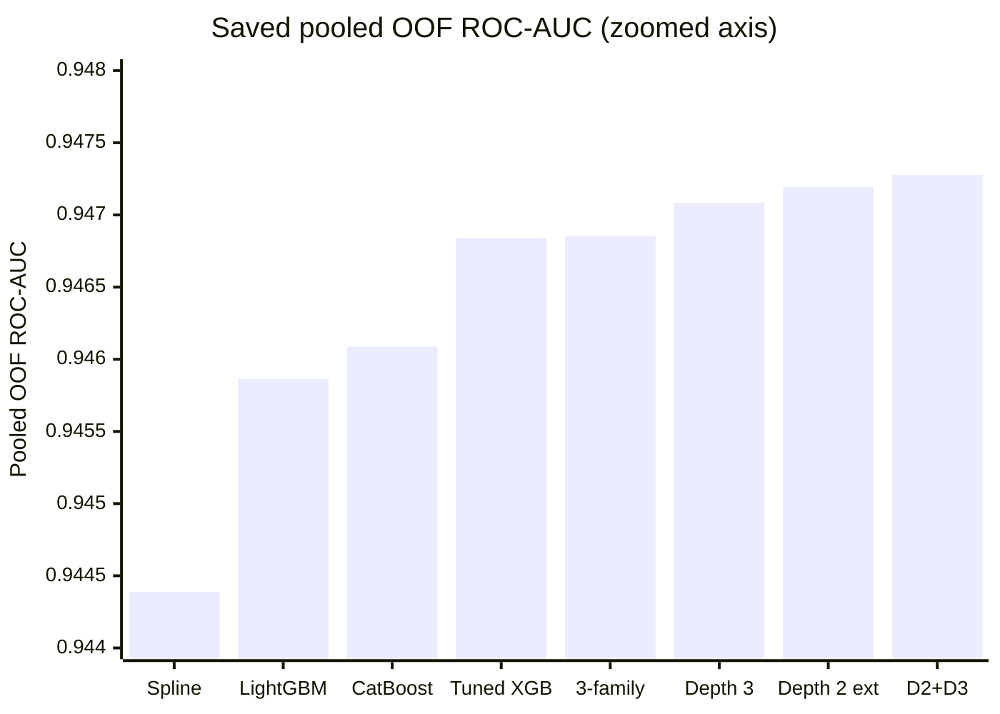
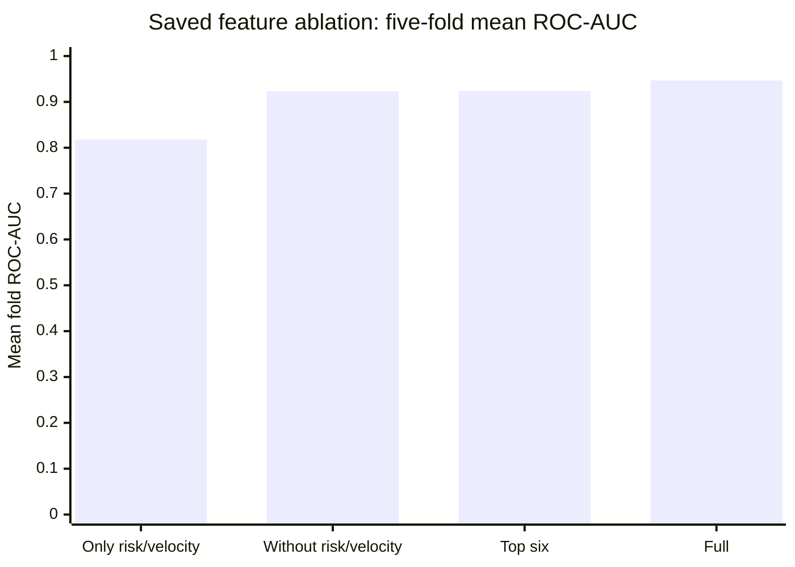

# Credit-card fraud: shallow trees, careful validation

A notebook-led study for [Kaggle Playground Series S6E11](https://www.kaggle.com/competitions/playground-series-s6e11/data): predict `is_fraud` from transaction attributes, compare model families, investigate errors, and test a small shallow-tree ensemble.

**Best recorded exploratory pooled OOF ROC-AUC: 0.947278**, from an equal-weight depth-2/depth-3 XGBoost blend. This is a saved local validation result, **not a Kaggle leaderboard score**. Full training was not rerun when preparing this study. The notebook's default execution is explicitly a smoke check.

## Three files, one workflow

- `README.md`: data instructions, verified historical results, findings, and limitations.
- [main.ipynb](main.ipynb): self-contained, explained workflow with plots and optional investigations.
- `.gitignore`: publishes only these three files; datasets, environments, checkpoints, outputs, original notebook, and older scaffolding stay local.

The existing original notebook and older project files are preserved, not deleted. No external source modules or configuration files are required. The ignore rule does not untrack files that were already committed; none were tracked during preparation.

## Get the data and run

1. Sign in to Kaggle, open the [competition data page](https://www.kaggle.com/competitions/playground-series-s6e11/data), and accept the competition rules if prompted.
2. Download and extract `train.csv`, `test.csv`, and `sample_submission.csv` into a local `data/` folder beside the notebook. Do not commit the data or Kaggle credentials.
3. Create a Python environment and install the packages below. Versions shown are the local verification environment, not a guarantee of identical results on other platforms.

```sh
python3 -m venv .venv
source .venv/bin/activate
python -m pip install numpy==2.5.5 pandas==3.1.1 scikit-learn==1.9.1 xgboost==3.4.1 matplotlib==3.11.2 jupyterlab ipykernel
python -m ipykernel install --user --name fraud-study --display-name "Fraud study"
python -m jupyterlab main.ipynb
```

Select the **Fraud study** kernel. The preparation environment used Python 3.14.7. Optional branches additionally require:

```sh
python -m pip install lightgbm==4.7.0 catboost==1.2.10 optuna==5.1.0
```

Run all cells from a fresh kernel. Default `SMOKE = True` uses 5,000 stratified rows, five folds, and at most 20 boosting rounds; its scores are **not benchmark results**. Set `SMOKE = False` for full training (potentially lengthy). Turn on individual `RUN_*` flags for model benchmarks, tuning, ablations, permutation importance, or adversarial validation. All are explained in the notebook. `EXPORT_SUBMISSION` is off by default; full-mode export writes only a local ignored file and never uploads it.

The notebook prints versions, seeds, and the training file hash. It needs no original notebook, `src/`, requirements file, or saved study object.

## Experimental methodology

1. **Problem and data understanding:** inspect target prevalence, schema, missingness, duplicates, and feature availability; remove ID from predictors.
2. **Validation design:** five shuffled stratified outer folds, seed 123. Reserve 15% of each outer training fold for early stopping, seed 42; learn category vocabularies only on fitting rows. Unknown categories become missing. Do not refit stopping rows.
3. **Baseline:** constant prediction, then an untuned XGBoost; distinguish this baseline from the frozen tuned reference.
4. **Iterative development:** compare model families, inspect OOF errors, investigate feature hypotheses, and optionally tune with Optuna. These steps inform each other.
5. **Ensemble and ablation:** compare fixed blends and paired feature/depth experiments on identical splits; retain negative findings.
6. **Evaluation and limitations:** report mean fold AUC and pooled OOF AUC separately, add average precision, disclose selection bias, and reserve independent evaluation for a future study.

Mean fold ROC-AUC averages five separate rankings. Pooled OOF ROC-AUC evaluates all held-out predictions together, including cross-fold comparisons. They need not be equal. Fold standard deviations are descriptive, not confidence intervals.

## Verified historical results

These values were transcribed from **saved outputs**, not recalculated from saved prediction arrays or reproduced by new full-data training. Cell references are zero-based indices in the preserved `main_with_stratifiedKFold.ipynb`; the public notebook carries the same evidence table and explanations. A dash means that metric was not displayed, not zero.

| Experiment | 5-fold mean AUC | Pooled OOF AUC | Source cell |
|---|---:|---:|---:|
| Tuned XGBoost reference | 0.946910 | 0.946842 | 7 |
| LightGBM | 0.945912 | 0.945864 | 7 |
| CatBoost | 0.946095 | 0.946087 | 7 |
| Equal XGBoost + LightGBM + CatBoost | — | 0.946854 | 7 |
| Spline logistic regression | 0.944404 | 0.944389 | 19 |
| Depth 1, up to 1,500 rounds | 0.945770 | 0.945761 | 21 |
| Depth 2, up to 1,500 rounds | 0.947078 | 0.947061 | 21 |
| Depth 3, up to 1,500 rounds | 0.947114 | 0.947083 | 21 |
| Depth 4, up to 1,500 rounds | 0.946631 | 0.946579 | 21 |
| Depth 2 + 3, both up to 1,500 rounds | — | 0.947220 | 22 |
| Depth 1, up to 4,000 rounds | 0.946500 | 0.946461 | 23 |
| Depth 2, up to 4,000 rounds | 0.947226 | 0.947196 | 23 |
| Extended depth 2 + depth 3, equal weights | — | **0.947278** | 24 |

The tuned XGBoost mean has population fold SD **0.001423**. The best blend's gain over extended depth 2 is about **0.000082**; this is not an established statistically significant improvement.



This graph uses a zoomed axis to show small differences. Tables remain readable if a Markdown viewer does not render Mermaid; the notebook also renders Matplotlib charts without external assets.

### Feature ablations and interactions

| Experiment | 5-fold mean AUC | Change vs full | Source cell |
|---|---:|---:|---:|
| Full feature set | 0.946910 | — | 10 |
| Remove risk and velocity | 0.923393 | -0.023517 | 10 |
| Only risk and velocity | 0.817603 | -0.129307 | 10 |
| Six historically important features | 0.923875 | -0.023035 | 10 |
| H1: risk/velocity/CVV interactions | 0.946681 | -0.000229 | 13 |
| H2: authentication interactions | 0.946348 | -0.000562 | 13 |
| H3: amount/balance interactions | 0.946919 | +0.000009 | 13 |
| H4: security interactions | 0.947040 | +0.000130 | 13 |
| All four interaction groups | 0.946253 | -0.000657 | 13 |



## Findings from the investigation

- **Rare positives:** local full data has 699,960 rows, 24 predictors, and 11,689 fraud labels (1.67%). No missing values or duplicate feature/label rows were found during preparation. The notebook checks these properties again.
- **Full features matter:** saved permutation importance ranked velocity (AUC drop 0.059282), merchant risk (0.050823), CVV retries (0.031997), and authentication (0.022062) highest (cell 9). This is model reliance, not causal importance. Removing risk/velocity hurts, but those two features alone are insufficient.
- **Limited blend diversity:** the three boosting models' prediction correlations were 0.983–0.988 (cell 7); the blend barely improved on XGBoost. The spline mix similarly offered little gain: best recorded candidate, 90% XGBoost / 10% spline, scored 0.946857 OOF (cell 20).
- **Interactions are not automatically useful:** security interactions won three of five folds and improved the mean slightly; all groups together reduced it. No significance claim is made.
- **Risk segments:** the historical top risk/velocity segment had 29,544 rows and 9.10% fraud (cells 14–16). Three CVV retries had only three examples in that segment; a 100% observed fraud rate is not robust evidence. The notebook retains rate/count heatmaps, residuals, and segment tables.
- **Train/test discrimination:** historical adversarial AUC was 0.500373 (cell 18). This model detected little separation; it does not establish no distribution shift or leakage.
- **Digit hypothesis unfinished:** historical digit-distribution plots existed, but the final evaluation cell contained Markdown inside Python and had no saved metrics. The new notebook includes valid optional paired evaluations and makes no historical performance claim.

## What these results do not establish

The original benchmark and Optuna search reused their scoring folds for stopping. The corrected three-model experiment separated stopping and scoring; historical depth/ablation cells still built categories globally. The new notebook consistently learns categories within fitting rows, so it is a corrected rerun workflow rather than a promise to match every old decimal. The new spline comparison also uses the shared fitting subset rather than the historical full outer training fold.

**Repeated validation selection bias remains.** Hyperparameters, features, depths, and blend candidates were explored repeatedly on this dataset. Separate early-stopping rows do not make tuning fully nested. Use a previously untouched holdout or repeat all selection inside nested outer folds before making independent generalization claims.

Random stratification cannot establish performance on future transactions or unseen customers: no absolute timestamp or customer grouping ID is available. Feature availability at transaction time, especially risk/velocity/scam indicators, needs verification. ROC-AUC does not select an operational threshold; costs, calibration, precision/recall, and false-positive budgets require separate evaluation. No public/private leaderboard score or competition rank is claimed.

The earlier conversational initial AUC of 0.90625 and hard-coded old benchmark value 0.946670 lack verified run evidence in the source and are intentionally excluded.

## Provenance and verification

Original notebook SHA-256: `e81712caaea9f370e00b7dccdfd01565fdcf14cdddf6d5ee1ab81837419f707a`.

Preparation checks: notebook JSON/schema and Python syntax; sequential real-data smoke execution; optional branches checked with reduced budgets. These verify basic functionality, not the historical full-data scores. Runtime outputs in `main.ipynb` are labeled **SMOKE CHECK**; its historical tables are explicitly labeled separately. Models train locally; no other participants' predictions are imported. No GitHub push was performed.
